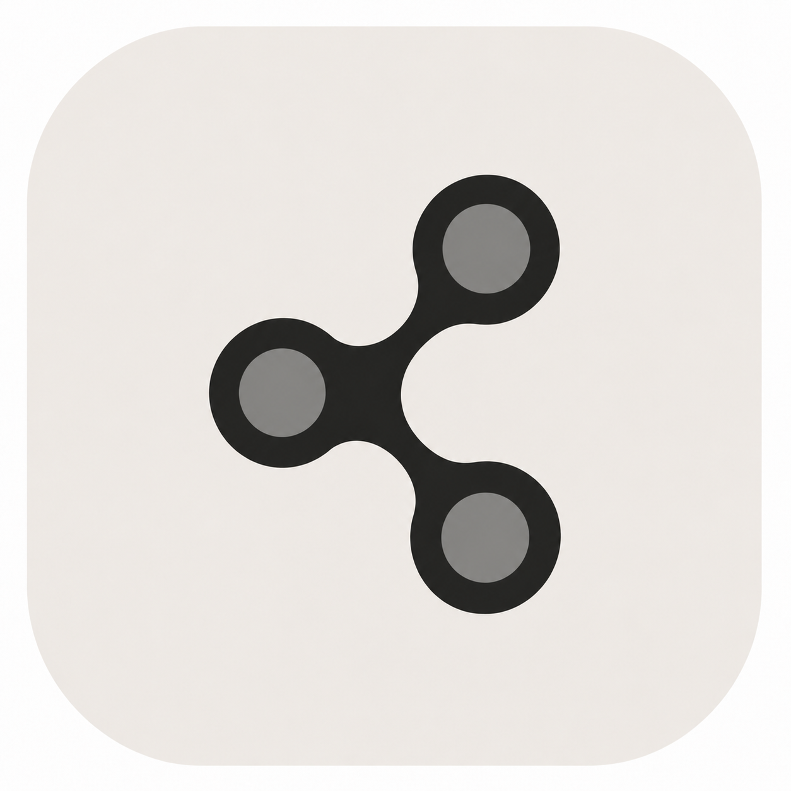

<div align="center">



# CamNode

**Tus teléfonos Android pueden cuidar de tu hogar.**

Convierte teléfonos que ya no usas en cámaras y míralas desde otros dispositivos,
con conexión directa en tu red o acceso remoto mediante Tailscale.

[Primeros pasos](#primeros-pasos) · [Grabación en PC](#grabación-en-una-pc) · [Desarrollo](#desarrollo) · [Arquitectura](docs/arquitectura.md)

</div>

## Qué puedes hacer

- **Ver video en vivo.** Usa un teléfono como cámara y consulta las cámaras de tu hogar desde otro. Cambia de lente y activa el sonido desde el visor.
- **Conectarte desde casa o fuera.** En la misma red Wi-Fi, las cámaras se descubren automáticamente. Para el acceso remoto, conecta los dispositivos a la misma red de Tailscale.
- **Recibir alertas.** Designa un teléfono para recibir una notificación cuando se mueva una cámara.
- **Grabar en una PC.** Guarda segmentos de video y recibe alertas con el grabador de escritorio.
- **Administrar el hogar.** Invita dispositivos con un código QR, consulta su batería y configura el acceso con PIN.
- **Personalizar la app.** Elige entre diez idiomas y, si quieres, disfraza la app de calculadora, reloj, calendario o notas.

Los dispositivos se comunican directamente, sin un servidor ni una nube intermedia de CamNode.

## Requisitos

- Android 9 (API 28) o superior en cada teléfono.
- Una red Wi-Fi compartida para el uso dentro de casa.
- Tailscale conectado a la misma cuenta o tailnet en cada teléfono para el acceso remoto.
- Un cargador para cada teléfono que transmita de forma continua.

## Primeros pasos

1. Abre CamNode en el primer teléfono y selecciona **Crear mi hogar**.
2. En otro teléfono, selecciona **Unirme con una invitación**. Escanea el código de **Hogar → Invitar dispositivo** o abre el enlace de invitación compartido.
3. En el teléfono que usarás como cámara, abre **Transmitir** y pulsa **Iniciar transmisión**. Revisa **Funcionamiento continuo** para evitar que el sistema cierre la transmisión.
4. En el teléfono visor, abre **Cámaras** y toca una cámara para verla a pantalla completa.
5. Para recibir avisos de movimiento de la cámara, abre **Alertas** en el teléfono que llevas contigo y activa **Este es un teléfono maestro**.

La transmisión continúa con la pantalla apagada o mientras usas otras aplicaciones. También puedes copiar el enlace de la tarjeta **Conexión** para ver la cámara en VLC.

## Opciones del hogar

En **Hogar** puedes consultar la batería de los dispositivos, cambiar el idioma y activar el bloqueo de la app con un PIN de cuatro dígitos. El disfraz de la app ofrece tres iconos para cada apariencia. La notificación de la cámara sigue mostrando el nombre CamNode.

La app está disponible en español, inglés, portugués, francés, alemán, hindi, indonesio, árabe, chino y ruso. Por defecto usa el idioma del teléfono.

## Grabación en una PC

El grabador necesita Java 17 o superior y `ffmpeg`. Obtén el enlace desde **Hogar → Invitar dispositivo → Compartir** y ejecuta:

```sh
./gradlew :recorder:installDist
recorder/build/install/camnode-recorder/bin/camnode-recorder join "<enlace de invitación>" --dir ~/CamNode
recorder/build/install/camnode-recorder/bin/camnode-recorder run
```

El grabador guarda todas las cámaras en segmentos de cinco minutos, elimina las grabaciones de más de siete días y recibe las alertas de movimiento. Consulta la [arquitectura](docs/arquitectura.md) para conocer más opciones y límites.

## Desarrollo

El proyecto usa Kotlin, Jetpack Compose, CameraX y Gradle. Para ejecutar las comprobaciones y generar el APK de depuración:

```sh
./gradlew test lint assembleDebug :recorder:installDist
```

El APK se genera en `app/build/outputs/apk/debug/`. La [documentación de arquitectura](docs/arquitectura.md) describe los módulos, el contrato entre dispositivos y las decisiones de seguridad.
